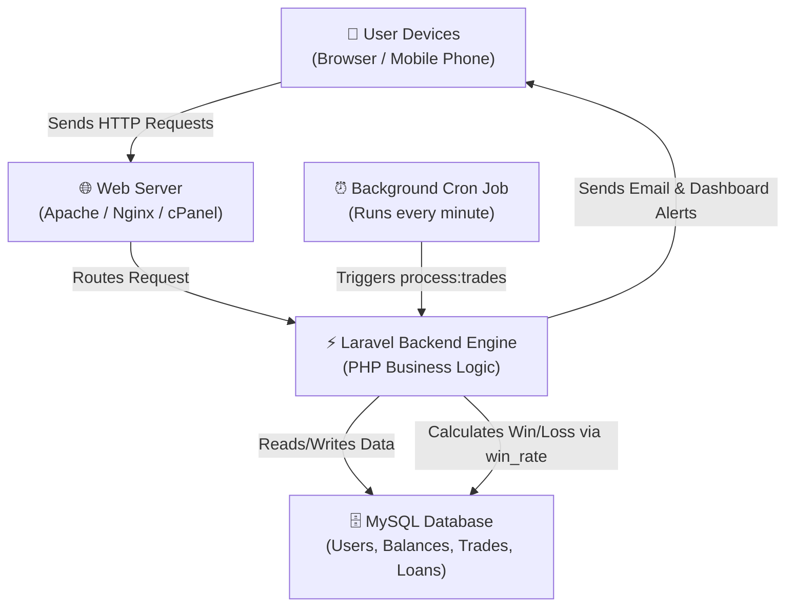
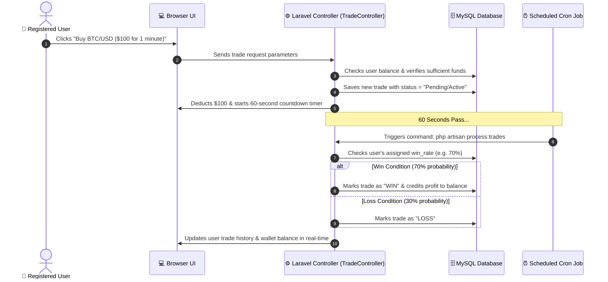
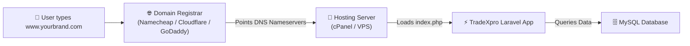
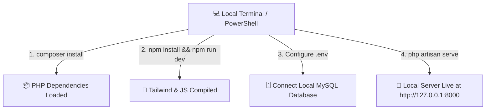
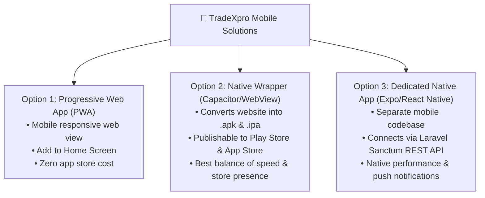
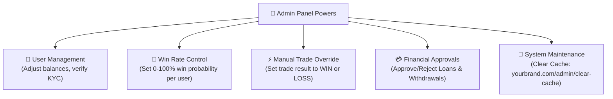

# 🚀 TradeXpro (TRS) — Ultimate Beginner's Guide & Project Documentation

Welcome to **TradeXpro**! This document is created specifically for **beginners** to help you understand your codebase, how it works under the hood, how to host it live on the web with a custom domain, how to run it locally on your computer, and how to convert it into a mobile app for Android and iOS.

---

## 📌 Quick Summary Table of Contents

1. [💡 What is TradeXpro? (Simple Explanation)](#-what-is-tradexpro-simple-explanation)
2. [⚙️ How the Entire Codebase Works (System Architecture & Diagrams)](#️-how-the-entire-codebase-works-system-architecture--diagrams)
3. [🛠️ Technology Stack Explained Simply](#️-technology-stack-explained-simply)
4. [📂 Codebase Structure & Key Files](#-codebase-structure--key-files)
5. [🌐 How to Host TradeXpro as a Website & Get a Domain](#-how-to-host-tradexpro-as-a-website--get-a-domain)
   - [Step 1: Buying a Domain Name](#step-1-buying-a-domain-name)
   - [Step 2: Buying Web Hosting (cPanel / VPS)](#step-2-buying-web-hosting-cpanel--vps)
   - [Step 3: Connecting Your Domain to Your Hosting](#step-3-connecting-your-domain-to-your-hosting)
   - [Step 4: Uploading & Installing TradeXpro](#step-4-uploading--installing-tradexpro)
   - [Step 5: Setting Up Cron Jobs (Crucial Step)](#step-5-setting-up-cron-jobs-crucial-step)
6. [💻 How to Run TradeXpro Locally on Your PC](#-how-to-run-tradexpro-locally-on-your-pc)
7. [📱 How to Run / Convert TradeXpro into a Mobile App](#-how-to-run--convert-tradexpro-into-a-mobile-app)
   - [Option 1: Progressive Web App (PWA) — Instant & Zero Cost](#option-1-progressive-web-app-pwa--instant--zero-cost)
   - [Option 2: Native App Wrapper (Capacitor / WebView) — Google Play & Apple App Store](#option-2-native-app-wrapper-capacitor--webview--google-play--apple-app-store)
   - [Option 3: Dedicated Native App (Expo / React Native)](#option-3-dedicated-native-app-expo--react-native)
8. [🔑 Admin Dashboard & Operational Features](#-admin-dashboard--operational-features)
9. [❓ FAQ & Troubleshooting for Beginners](#-faq--troubleshooting-for-beginners)

---

## 💡 What is TradeXpro? (Simple Explanation)

Imagine **TradeXpro** as a digital online financial web application (like a web-based trading broker platform). 

It allows registered users to:
* 📈 **Trade Assets:** Place trades (Buy or Sell) on Crypto, Forex, or Stocks with set time countdowns (e.g. 1 minute, 5 minutes, 1 day) and leverage (e.g. 5x, 10x).
* 👥 **Copy Expert Traders:** Follow top traders and automatically replicate their trading activity with profit-sharing.
* 🖼️ **Buy/Sell/Mint NFTs:** An internal marketplace where users can mint, buy, bid, and sell digital artwork without needing complex blockchain wallets.
* 📡 **Signal Subscriptions:** Subscribe to premium daily/weekly trading signals sent directly via email and user dashboard.
* 💳 **Deposit & Withdraw Funds:** Support for multiple payment gateways (Stripe, Paystack, Flutterwave, BitPay, Crypto) and user wallet tracking.
* 💰 **Apply for Digital Loans:** Apply for instant loans approved manually by the Administrator.

Everything is managed by **YOU** (the Administrator) through an **Admin Control Panel**.

---

## ⚙️ How the Entire Codebase Works (System Architecture & Diagrams)

To understand how TradeXpro works as a complete system, let's break it down visually.

### 1. High-Level Architecture Sketch



---

### 2. Step-by-Step Flow: How a Trade Executes Under the Hood

When a user places a trade on your site, here is the exact step-by-step sequence:



---

## 🛠️ Technology Stack Explained Simply

Think of the technology stack like building a house:

| Technology | Role | Analogy |
| :--- | :--- | :--- |
| **PHP 8 & Laravel 8** | Backend Framework | **The Foundation & Plumbing:** Handles security, routes, user login, trading rules, and database communication. |
| **MySQL** | Database System | **The Secure Vault:** Stores passwords, user balances, trade logs, loan requests, and system settings. |
| **HTML5 & Blade Templates** | Web Page Views | **The Walls & Structure:** Formats the layout of every web page. |
| **Tailwind CSS & Alpine.js** | Styling & Front-end Logic | **The Interior Decor & Paint:** Makes the website look clean, dark-mode modern, and smooth on mobile screens. |
| **Livewire & AJAX** | Real-time Updates | **The Live Sensors:** Updates balances and trade countdown timers without refreshing the browser page. |
| **Composer & NPM** | Package Managers | **The Toolbox:** Installs tools and libraries needed by PHP and JavaScript. |

---

## 📂 Codebase Structure & Key Files

Here is a simplified directory map of your project files so you know where everything lives:

```
TRS/
├── app/                              <-- Core Backend Logic
│   ├── Http/Controllers/            <-- Web Request Handlers
│   │   ├── Admin/                   <-- Admin panel actions (Users, Trades, Loans, Deposits)
│   │   ├── User/                    <-- User dashboard actions
│   │   ├── AutoTaskController.php   <-- ROI top-up & auto-cron tasks
│   │   ├── BuyController.php        <-- Trade buying logic
│   │   └── LoanController.php       <-- Digital loan application handler
│   ├── Models/                      <-- Database models (User.php, Trade.php, Loan.php, Nft.php)
│   └── Console/Commands/            <-- Scheduled commands (e.g., process:trades)
├── bootstrap/                        <-- Framework startup scripts
├── config/                           <-- Configuration settings (database, app, mail, payments)
├── database/                         <-- Database migrations & table schemas
├── public/                           <-- Public root folder (index.php, CSS, JS, images)
├── resources/                        <-- Frontend Templates
│   ├── views/                        <-- HTML/Blade files for admin & user dashboards
│   └── css/ & js/                    <-- Stylesheets and frontend JavaScript
├── routes/                           <-- URL Routing Rules
│   ├── web.php                       <-- Main web routes & Cron URLs
│   ├── admin/web.php                 <-- Admin dashboard URLs
│   ├── user/web.php                  <-- User dashboard URLs
│   └── api.php                       <-- API endpoints (used by mobile apps)
├── .env                              <-- SECRET CONFIGURATION FILE (DB details, app URL)
├── composer.json                     <-- PHP dependency registry
└── package.json                      <-- JS dependency registry
```

* 🔗 Key files to inspect:
  * [web.php](file:///c:/Users/AKPORHIEGBE%20SOLOMON/OneDrive/Documents/TRS/routes/web.php) — Main web routes & cron endpoints
  * [api.php](file:///c:/Users/AKPORHIEGBE%20SOLOMON/OneDrive/Documents/TRS/routes/api.php) — Mobile API endpoints
  * [composer.json](file:///c:/Users/AKPORHIEGBE%20SOLOMON/OneDrive/Documents/TRS/composer.json) — Backend dependencies
  * [package.json](file:///c:/Users/AKPORHIEGBE%20SOLOMON/OneDrive/Documents/TRS/package.json) — Frontend assets & packages

---

## 🌐 How to Host TradeXpro as a Website & Get a Domain

Since you want to launch TradeXpro as a live website, here is a complete beginner step-by-step roadmap to hosting your platform online.

### Overview Diagram of Web Hosting & Domain Flow



---

### Step 1: Buying a Domain Name
A **domain name** is your web address on the internet (e.g. `www.mytradexpro.com`).
1. Go to a trusted domain registrar such as **Namecheap**, **Cloudflare**, **Hostinger**, or **GoDaddy**.
2. Search for your desired name (e.g., `mytradexpro.com`).
3. Purchase the `.com` domain (usually costs around **$10 – $14 per year**).

---

### Step 2: Buying Web Hosting (cPanel / VPS)
Web hosting is the 24/7 internet computer where your project files and database will live.
* **Recommended Hosting Type for Beginners:** **cPanel Shared Hosting** or **cPanel Business Hosting** (offered by Hostinger, Namecheap, Bluehost, or A2 Hosting).
* **Requirements:**
  * **PHP Version:** PHP `8.0` or `8.1` (Ensure your host supports PHP 8+).
  * **Database:** MySQL `5.7+` or MariaDB.
  * **Extensions:** `OpenSSL`, `PDO`, `Mbstring`, `Tokenizer`, `XML`, `CURL`, `Fileinfo`.

---

### Step 3: Connecting Your Domain to Your Hosting
1. Log into your hosting account dashboard and copy your **Nameservers** (e.g., `ns1.hostingprovider.com` and `ns2.hostingprovider.com`).
2. Log into your domain registrar (where you bought your domain in Step 1).
3. Go to **DNS Management / Nameservers** and replace the default nameservers with your hosting nameservers.
4. Wait 10 to 30 minutes for DNS propagation. Now typing `www.yourbrand.com` points directly to your hosting server!

---

### Step 4: Uploading & Installing TradeXpro on cPanel

1. **Prepare Your Project Files:**
   * Compress all project files in your repository into a `.zip` file (or use your project zip file).
2. **Upload to cPanel:**
   * Log into your **cPanel Dashboard**.
   * Click on **File Manager**.
   * Navigate to `public_html` (or your subdomain folder).
   * Click **Upload** and upload your zip file, then click **Extract**.
3. **Create MySQL Database & Database User:**
   * In cPanel, click **MySQL Database Wizard**.
   * Step 1: Create Database Name (e.g., `yourusername_tradexpro`).
   * Step 2: Create Database User (e.g., `yourusername_tradeuser`) and set a strong password.
   * Step 3: Select **ALL PRIVILEGES** and click Save.
4. **Import Database SQL:**
   * In cPanel, click **phpMyAdmin**.
   * Select your newly created database on the left sidebar.
   * Click **Import** at the top tab, select your `database.sql` file, and click **Go**.
5. **Configure `.env` File:**
   * In cPanel File Manager, locate the `.env` file inside your project root.
   * Click **Edit** and update the following configuration lines:
     ```env
     APP_NAME=TradeXpro
     APP_ENV=production
     APP_DEBUG=false
     APP_URL=https://yourbrand.com

     DB_CONNECTION=mysql
     DB_HOST=127.0.0.1
     DB_PORT=3306
     DB_DATABASE=yourusername_tradexpro
     DB_USERNAME=yourusername_tradeuser
     DB_PASSWORD=your_strong_database_password
     ```
   * *Security Tip:* Change file permission of `.env` to `600` or `644` in cPanel File Manager.

---

### Step 5: Setting Up Cron Jobs (Crucial Step)

Cron jobs are automatic timers on your hosting server that run key actions in the background (like trade countdown expiration, win/loss calculation, and daily ROI investments).

1. In cPanel, search for **Cron Jobs**.
2. Under *Add New Cron Job*, set the frequency to **Every Minute** (`* * * * *`).
3. Add the following command (replace `yourusername` with your cPanel username):
   ```bash
   /usr/bin/php /home/yourusername/public_html/artisan process:trades >> /dev/null 2>&1
   ```
4. *Alternative Web Cron Option:*
   If your host limits shell commands, set a Web Cron / External Cron service (like cron-job.org) to hit this URL every minute:
   `https://yourbrand.com/run-profit-return?key=remedy6034`
5. **Daily Investment Topup Cron:**
   Set a second daily cron job targeting:
   `https://yourbrand.com/cron`

---

## 💻 How to Run TradeXpro Locally on Your PC

If you want to test and edit the code locally on your own computer before uploading to hosting, follow these steps:

### Prerequisites Needed on Your PC:
1. **XAMPP** or **Laragon** (Provides PHP 8 & MySQL Database server locally).
2. **Composer** (PHP Package Manager — Download from https://getcomposer.org).
3. **Node.js & NPM** (JavaScript package runner — Download from https://nodejs.org).

### Local Setup Diagram



### Step-by-Step Local Commands:

1. **Open PowerShell / Command Prompt** in your project directory:
   ```powershell
   cd "c:\Users\AKPORHIEGBE SOLOMON\OneDrive\Documents\TRS"
   ```

2. **Install PHP Packages:**
   ```bash
   composer install
   ```

3. **Install & Compile Frontend Assets:**
   ```bash
   npm install
   npm run dev
   ```

4. **Create Local Database:**
   * Open XAMPP Control Panel and start **Apache** and **MySQL**.
   * Go to `http://localhost/phpmyadmin` in your browser.
   * Click **New Database** and create a database named `tradexpro_db`.
   * Import the database SQL schema file into `tradexpro_db`.

5. **Setup Environment File:**
   * Duplicate `.env.example` and rename it `.env`.
   * Configure database details:
     ```env
     DB_CONNECTION=mysql
     DB_HOST=127.0.0.1
     DB_PORT=3306
     DB_DATABASE=tradexpro_db
     DB_USERNAME=root
     DB_PASSWORD=
     ```

6. **Generate Application Encryption Key:**
   ```bash
   php artisan key:generate
   ```

7. **Create Storage Link for Images & Uploads:**
   ```bash
   php artisan storage:link
   ```

8. **Start Local Server:**
   ```bash
   php artisan serve
   ```
   * Open your browser and go to `http://127.0.0.1:8000`.

---

## 📱 How to Run / Convert TradeXpro into a Mobile App

You asked how to run TradeXpro as a mobile app. Here are the 3 main approaches:



---

### Option 1: Progressive Web App (PWA) — *Instant & Zero Cost*
TradeXpro's frontend is built with Tailwind CSS and Livewire, meaning it automatically adjusts seamlessly to mobile screen sizes (smartphones & tablets).
* **How it works:** Users open Safari (iPhone) or Chrome (Android), go to `https://yourbrand.com`, and tap **"Add to Home Screen"**.
* **Result:** It installs an app icon on their phone home screen that launches full-screen like a native app without needing App Store approval!

---

### Option 2: Native App Wrapper (Capacitor / WebView) — *Recommended for Google Play & Apple App Store*
You can convert your live web application into native Android (`.apk` / `.aab`) and iOS (`.ipa`) app packages using **Ionic Capacitor**.

#### Step-by-Step Wrapper Setup:
1. First, host your web application on a live domain (e.g. `https://yourbrand.com`).
2. Open your terminal in the project directory and install Capacitor:
   ```bash
   npm install @capacitor/core @capacitor/cli
   npx cap init TradeXpro com.tradexpro.app --web-dir public
   ```
3. Add Android and iOS platforms:
   ```bash
   npx cap add android
   npx cap add ios
   ```
4. Open `capacitor.config.json` and set your live site URL:
   ```json
   {
     "appId": "com.tradexpro.app",
     "appName": "TradeXpro",
     "webDir": "public",
     "server": {
       "url": "https://yourbrand.com",
       "cleartext": true
     }
   }
   ```
5. Open Android Studio / Xcode to build the release binary:
   ```bash
   npx cap open android
   ```
6. Export the `.apk` or `.aab` file and publish directly to the Google Play Store and Apple App Store!

---

### Option 3: Dedicated Native App (Expo / React Native)
If you want to build a completely separate native mobile app in the future:
* The codebase already has API endpoints configured in [routes/api.php](file:///c:/Users/AKPORHIEGBE%20SOLOMON/OneDrive/Documents/TRS/routes/api.php) using **Laravel Sanctum**.
* An `.expo` directory exists in the workspace. A React Native or Flutter developer can create a mobile UI that connects directly to your backend API endpoints for authentication, trade placement, deposit requests, and loan applications.

---

## 🔑 Admin Dashboard & Operational Features

Once your app is live, you can access the powerful Admin Control Panel:

* **Admin URL:** `https://yourbrand.com/admin/login`
* **Default Admin Email:** `admin@admin.com`
* **Default Admin Password:** `admin123` *(Change password immediately upon first login!)*



### 🎯 How User Win Rates Work:
* In TradeXpro, each user has a `win_rate` value (between 0 and 100) set by the Admin:
  * **`win_rate = 70`**: User has a **70% probability to WIN** trades.
  * **`win_rate = 30`**: User has a **30% probability to WIN** trades (70% chance to lose).
  * **Manual Override:** Admin can manually force any active or pending trade to output as WIN or LOSS anytime.

---

## ❓ FAQ & Troubleshooting for Beginners

#### 1. What do I do if I see a "500 Internal Server Error"?
* **Cause:** Missing `.env` file, missing application key, or database connection mismatch.
* **Fix:** Ensure `.env` exists in your server folder, verify database credentials in `.env`, and run `php artisan key:generate`.

#### 2. Why are trade countdown timers not finishing automatically?
* **Cause:** The server Cron job is not configured or not firing every minute.
* **Fix:** Ensure the cPanel cron command is active or trigger it manually by visiting:
  `https://yourbrand.com/run-profit-return?key=remedy6034`

#### 3. How do I clear cache when I change settings or code?
* Visit `https://yourbrand.com/admin/clear-cache` in your browser or run:
  ```bash
  php artisan config:clear && php artisan cache:clear && php artisan view:clear
  ```

#### 4. Do I need expensive Web3 blockchain node setup for NFTs?
* **No!** TradeXpro includes an off-chain Web2 simulated NFT marketplace engine. Users buy, sell, and mint NFTs using their account wallet balances without needing complex crypto extension wallets like MetaMask.

---

*Documentation created for TradeXpro Codebase.*